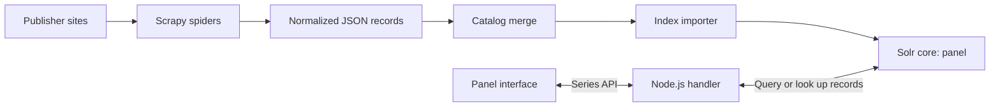

# Panel architecture and handoff

Panel has a collection job, a search service, and a web interface. Collection runs whenever we refresh the catalog. A reader's search goes through the existing index, so it can return results while the collector is idle.

## Framework and hierarchy

| Layer | Tool | Responsibility |
| --- | --- | --- |
| Collection | Python and Scrapy | Visit publisher pages, extract metadata, and export a JSON array of normalized manga records per source. A merge step combines them into one catalog. |
| Index | Apache Solr | Store the records, tokenize searchable fields, rank matches, and return a page of results. |
| API | Node.js | Validate browser requests, translate them to Solr queries, and return the JSON contract below. |
| Interface | HTML, CSS, and browser JavaScript | Render Panel's search, browse, and series detail flows. |



The component diagram maps the actual code. The framework subclasses we define are the four spiders, which extend Scrapy's `Spider`. Scrapy calls their callbacks with each downloaded page and writes the records they yield. The rest of Panel uses modules and passes plain JSON records between them.

```text
Info-Ret-Project/
├── collection/
│   ├── scrapy.cfg, requirements.txt
│   ├── fixtures/manga.html             Hand-written, local catalog for development
│   ├── data/catalog.json               Merged catalog snapshot, one record per line
│   └── panel_collection/
│       ├── settings.py                Shared crawl defaults
│       ├── records.py                 Build one normalized series record
│       ├── merge.py                   Merge source exports and report on coverage
│       └── spiders/
│           ├── sample.py              Reads the fixture
│           ├── viz.py                 VIZ Media
│           ├── sevenseas.py           Seven Seas Entertainment
│           └── yenpress.py            Yen Press
├── retrieval/
│   ├── index.mjs                      Validate JSON and upsert records into Solr
│   ├── solr.mjs                       HTTP client and catalog record mapping
│   ├── filters.mjs                    Translate filter selections to Solr queries
│   ├── snippets.mjs                   Request highlighting and map excerpts
│   └── dev-server.mjs                 Serve the frontend and API on localhost
├── api/series.mjs                      Search, browse, and detail handler
├── public/
│   ├── index.html, styles.css, assets/ Panel theme and page structure
│   ├── app.mjs                        Fetch records and handle user actions
│   ├── filters.mjs                    Mount the filter controls
│   ├── snippets.mjs                   Render the highlighted excerpt
│   └── results.mjs                    Render the results list
├── compose.yaml                        Run a local Solr core
└── vercel.json                         Vercel frontend output configuration
```

## Run it locally

Use Node.js 22 or newer and a running Docker engine with Compose. Run the commands below from the repo root. They load the committed catalog snapshot, so the team works on the same records without crawling.

```sh
docker compose up -d solr
```

Once Solr reports that its `panel` core is ready, import the records and start Panel.

```sh
node retrieval/index.mjs collection/data/catalog.json
node retrieval/dev-server.mjs
```

Open [Panel on localhost](http://127.0.0.1:4173). Browse the catalog, search for **Frieren**, and open the result to see its source link. Repeating the import updates records by ID. It never removes records, so empty a core that still holds the five-title sample before you import the catalog.

```sh
curl 'http://127.0.0.1:8983/solr/panel/update?commit=true' -H 'Content-Type: application/json' -d '{"delete":{"query":"*:*"}}'
```

For a local setup using Java, download the official Solr 10.1.0 release and use Java 21 or newer. From the unpacked Solr directory, run `bin/solr start --user-managed` and `bin/solr create -c panel --solr-url http://127.0.0.1:8983`. Then use the same import and Panel commands. If Solr is elsewhere, set `SOLR_URL` to its full core URL for both commands. [Apache Solr downloads](https://solr.apache.org/downloads)

## Collect the catalog

The catalog comes from three publisher sites. Each has its own spider, and every spider obeys the site's `robots.txt` and identifies itself as the course project.

| Spider | Site | How it finds series | Requests |
| --- | --- | --- | --- |
| `viz` | [VIZ Media](https://www.viz.com/manga-books) | `robots.txt` disallows the paged series lists, so the spider reads the monthly release calendar from 2002 on, opens one volume per series, and follows its link to the series page. | About 1,700, one every 3.25 seconds. The site answers 429 above roughly ten requests in 30 seconds. |
| `sevenseas` | [Seven Seas Entertainment](https://sevenseasentertainment.com/series-list/) | One alphabetical list links every series page. | About 1,260 |
| `yenpress` | [Yen Press](https://yenpress.com/category/manga) | The paged manga and comics lists link every series page. The first volume's page supplies the genres and the description. | About 2,350 |

A refresh needs Python 3.11 or newer. The VIZ crawl takes about an hour and a half, Yen Press about 50 minutes, and Seven Seas about 25 minutes. The three can run at the same time.

```sh
python3 -m venv .venv
source .venv/bin/activate
python -m pip install -r collection/requirements.txt
cd collection
python -m scrapy crawl viz -O ../.data/viz.json
python -m scrapy crawl sevenseas -O ../.data/sevenseas.json
python -m scrapy crawl yenpress -O ../.data/yenpress.json
python -m panel_collection.merge -o data/catalog.json ../.data/viz.json ../.data/sevenseas.json ../.data/yenpress.json
```

The merge prints the record count per source, the duplicate titles it merged, and how many records have a creator, description, genre, publisher, and debut year. Read that report before you commit a new `data/catalog.json`. The per-source exports in `.data/` and the local Python environment are ignored by Git.

While you change a spider, add `-s HTTPCACHE_ENABLED=1` to its crawl. Scrapy then keeps each downloaded page in `collection/.scrapy/`, and the next run parses the stored copies without contacting the site. `python -m scrapy crawl panel_sample -O ../.data/sample.json` still exports the five hand-written fixture records for work without a network.

### How records are normalized

- **Scope.** The catalog holds manga, manhwa, and other comics. Light novels, audiobooks, and art books in the publishers' lists are skipped.
- **Title and ID.** A trailing edition marker such as `(Manga)`, `(Omnibus)`, or `(v-scroll)` is dropped from the title. The ID is the title as a lowercase slug, so `Frieren: Beyond Journey’s End` becomes `frieren-beyond-journeys-end` on every crawl.
- **Merging.** Records with the same ID are one series when their creators share a name or one of them names no creator. The merged record keeps the first source's title, creator, description, and publisher, the union of aliases and genres, the earliest debut year, and every source URL. Sources merge in the order VIZ, Seven Seas, Yen Press. If two different series share a title, the later one gets the publisher appended to its ID.
- **Genres.** Publisher spellings map to one vocabulary in `records.py`, where `Action-Adventure` becomes `Action` and `Adventure`. Tags for format, audience, or licence, such as `Color` or `Anime Tie-in`, are dropped.
- **Publisher.** The English-language publisher whose site lists the series.
- **Debut year.** The year of first publication in the original language, taken only where the site states it. Seven Seas prints it in the copyright line. VIZ and Yen Press show English release dates only, so their records have `null`.

## The contracts everyone builds against

### One series record

The spiders and the merge output a JSON array with one record per series. Here is the record for Frieren.

```json
{
  "id": "frieren-beyond-journeys-end",
  "title": "Frieren: Beyond Journey’s End",
  "aliases": [],
  "creator": "Kanehito Yamada and Tsukasa Abe",
  "description": "The adventure is over but new life lessons await this young elf mage. Elf mage Frieren and her courageous fellow adventurers have defeated the Demon King and brought peace to the land. But Frieren will long outlive the rest of her former party. How will she come to understand what life means to the people around her?",
  "genres": ["Action", "Adventure", "Drama", "Fantasy"],
  "publisher": "VIZ Media",
  "debut_year": null,
  "source_urls": ["https://www.viz.com/frieren-beyond-journeys-end"]
}
```

`id`, `title`, and at least one source link are required. Keep IDs stable across imports and use the same ID when merging records for the same series. Preserve all source URLs when merging. Optional text defaults to an empty string, optional arrays default to an empty array, and unknown years come back as `null`.

### Search response

| Request | Response |
| --- | --- |
| `GET /api/series` | `{ items, total, page, page_size }` with titles in alphabetical order |
| `GET /api/series?q=Frieren&page=1` | Same shape, ranked by relevance. Title matches receive the highest weight. |
| `GET /api/series?id=frieren-beyond-journeys-end` | `{ item }` with the full series record, or a 404 if the ID is missing from the index |

`items` contains up to 12 series per page. A successful query can return an empty array. If Solr is unavailable, the API returns 503 and the page shows a message. The server owns the Solr URL and credentials. A future Vercel deployment connects its API to a separately hosted Solr core through server-side configuration.

### Follow one query

1. The browser sends `GET /api/series?q=Frieren&page=1`.
2. `api/series.mjs` validates the query and asks Solr to search title, aliases, creator, and description.
3. Solr ranks matching records and returns a page. The API maps those records to the series format above.
4. `public/app.mjs` renders the items. Clicking one asks the same API for its details by ID.

## Where each feature goes

Everyone builds on the catalog in `collection/data/catalog.json`. The baseline already calls each feature module, so each person can build in their own files. The catalog provides many genres, three publishers, debut decades from the 1970s on, and full descriptions.

| Owner | Feature | Start here |
| --- | --- | --- |
| Ale | Filtering | Use `public/filters.mjs` for the controls and `retrieval/filters.mjs` for Solr filter queries. Try combining Fantasy, Seven Seas Entertainment, and the 2010s in the catalog. |
| Tarun | Snippets and UI/UX lead | Use `retrieval/snippets.mjs` to request and read highlighting, and `public/snippets.mjs` to render it. Try searching for **magic**, which appears in multiple sample descriptions. |
| Jeffre | Tabular results | Replace the list in `public/results.mjs` with a table. Keep each title actionable and keep the call to the snippet renderer. The renderer returns `null` until snippets are available. |
| All three | Automatic recommendations | Build the recommender together using the shared catalog. Return similar series by ID with a reason that the interface can show alongside each suggestion. |

### Feature interfaces

- **Filtering.** `mountFilters(form, params)` adds named form controls and restores selections from the URL. The browser sends those values on search, browse, and page changes. `buildFilterQueries(params)` returns an array of Solr filter clauses, which the API forwards as repeated `fq` parameters. Start with the names `genre`, `publisher`, and `decade`.
- **Snippets.** `highlightParams(query)` supplies Solr highlighting options. `resultSnippet(highlighting, id)` maps the result to an array of `{ text, match }` segments for that series. The browser passes the array to `renderSnippet(segments)`, which returns an element or `null`. The default array is empty. Render the segments as text and wrap matching segments in `<mark>`.
- **Table.** `renderResults(container, items, openSeries)` owns the markup inside the results container. Use `openSeries(item.id)` for the series action and `renderSnippet(item.snippet ?? [])` for an optional excerpt.

Restart the local Node server after changing a retrieval or API module. Reload the page after changing browser code.

## Remaining baseline work for the submission

- Repeat the browse, title-search, and details checks on the real catalog after each catalog refresh. Run the usability sessions on that version with three classmates.
- Debut years cover the Seven Seas records only. Decide whether the decade filter treats the VIZ and Yen Press records as "unknown" or whether a fourth source should supply their original years.
