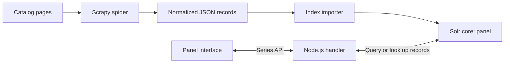

# Panel architecture and handoff

Panel has a collection job, a search service, and a web interface. Collection runs whenever we refresh the catalog. A reader's search goes through the existing index, so it can return results while the collector is idle.

## Framework and hierarchy

| Layer | Tool | Responsibility |
| --- | --- | --- |
| Collection | Python and Scrapy | Visit pages, extract metadata, and export a JSON array of normalized manga records. |
| Index | Apache Solr | Store the records, tokenize searchable fields, rank matches, and return a page of results. |
| API | Node.js | Validate browser requests, translate them to Solr queries, and return the JSON contract below. |
| Interface | HTML, CSS, and browser JavaScript | Render Panel's search, browse, and series detail flows. |



The component diagram maps the actual code. The one framework subclass we define is `SampleCatalogSpider`, which extends Scrapy's `Spider`. Scrapy calls its `parse(response)` method and writes the records it yields. The rest of Panel uses modules and passes plain JSON records between them.

```text
Info-Ret-Project/
├── collection/
│   ├── scrapy.cfg, requirements.txt
│   ├── fixtures/manga.html             Hand-written, local catalog for development
│   └── panel_collection/
│       ├── settings.py                Shared crawl defaults
│       └── spiders/sample.py           Spider that reads the fixture
├── retrieval/
│   ├── index.mjs                      Validate JSON and upsert records into Solr
│   ├── solr.mjs                       HTTP client and catalog record mapping
│   ├── filters.mjs                    Translate filter selections to Solr queries
│   ├── snippets.mjs                   Request highlighting and map excerpts
│   └── dev-server.mjs                 Serve the frontend and API on localhost
├── api/series.mjs                      Search, browse, and detail handler
├── public/
│   ├── index.html, styles.css, assets/ Panel theme and page structure
│   ├── app.mjs                        Fetch records and handle user actions
│   ├── filters.mjs                    Mount the filter controls
│   ├── snippets.mjs                   Render the highlighted excerpt
│   └── results.mjs                    Render the results list
├── compose.yaml                        Run a local Solr core
└── vercel.json                         Vercel frontend output configuration
```

## Run it locally

Use Python 3.11 or newer, Node.js 22 or newer, and a running Docker engine with Compose. Run the commands below from the repo root. They use the included fixture, so the team can start from the same five records.

```sh
python3 -m venv .venv
source .venv/bin/activate
python -m pip install -r collection/requirements.txt
docker compose up -d solr
(cd collection && python -m scrapy crawl panel_sample -O ../.data/sample.json)
```

Once Solr reports that its `panel` core is ready, import the records and start Panel.

```sh
node retrieval/index.mjs .data/sample.json
node retrieval/dev-server.mjs
```

Open [Panel on localhost](http://127.0.0.1:4173). Browse the catalog, search for **Frieren**, and open the result to see its source link. Repeating the import updates records by ID. The generated JSON and local Python environment are ignored by Git.

For a local setup using Java, download the official Solr 10.1.0 release and use Java 21 or newer. From the unpacked Solr directory, run `bin/solr start --user-managed` and `bin/solr create -c panel --solr-url http://127.0.0.1:8983`. Then use the same import and Panel commands. If Solr is elsewhere, set `SOLR_URL` to its full core URL for both commands. [Apache Solr downloads](https://solr.apache.org/downloads)

## The contracts everyone builds against

### One series record

Scrapy outputs a JSON array with one record per series. Here is the record for Frieren.

```json
{
  "id": "frieren",
  "title": "Frieren: Beyond Journey’s End",
  "aliases": ["Sousou no Frieren"],
  "creator": "Kanehito Yamada and Tsukasa Abe",
  "description": "After defeating the Demon King, an elf mage retraces old roads with new companions. Magic and adventure give way to questions about memory, time and friendship.",
  "genres": ["Fantasy", "Adventure"],
  "publisher": "VIZ Media",
  "debut_year": 2020,
  "source_urls": ["https://www.viz.com/frieren-beyond-journeys-end"]
}
```

`id`, `title`, and at least one source link are required. Keep IDs stable across imports and use the same ID when merging records for the same series. Preserve all source URLs when merging. Optional text defaults to an empty string, optional arrays default to an empty array, and unknown years come back as `null`.

### Search response

| Request | Response |
| --- | --- |
| `GET /api/series` | `{ items, total, page, page_size }` with titles in alphabetical order |
| `GET /api/series?q=Frieren&page=1` | Same shape, ranked by relevance. Title matches receive the highest weight. |
| `GET /api/series?id=frieren` | `{ item }` with the full series record, or a 404 if the ID is missing from the index |

`items` contains up to 12 series per page. A successful query can return an empty array. If Solr is unavailable, the API returns 503 and the page shows a message. The server owns the Solr URL and credentials. A future Vercel deployment connects its API to a separately hosted Solr core through server-side configuration.

### Follow one query

1. The browser sends `GET /api/series?q=Frieren&page=1`.
2. `api/series.mjs` validates the query and asks Solr to search title, aliases, creator, and description.
3. Solr ranks matching records and returns a page. The API maps those records to the series format above.
4. `public/app.mjs` renders the items. Clicking one asks the same API for its details by ID.

## Where each feature goes

Everyone can start from the five-title sample. The baseline already calls each feature module, so each person can build in their own files. The sample provides several genres, publishers, debut decades, and full descriptions.

| Owner | Feature | Start here |
| --- | --- | --- |
| Ale | Filtering | Use `public/filters.mjs` for the controls and `retrieval/filters.mjs` for Solr filter queries. Try combining Fantasy, Kodansha, and the 2010s in the sample. |
| Tarun | Snippets and UI/UX lead | Use `retrieval/snippets.mjs` to request and read highlighting, and `public/snippets.mjs` to render it. Try searching for **magic**, which appears in multiple sample descriptions. |
| Jeffre | Tabular results | Replace the list in `public/results.mjs` with a table. Keep each title actionable and keep the call to the snippet renderer. The renderer returns `null` until snippets are available. |
| All three | Automatic recommendations | Build the recommender together using the shared catalog. Return similar series by ID with a reason that the interface can show alongside each suggestion. |

### Feature interfaces

- **Filtering.** `mountFilters(form, params)` adds named form controls and restores selections from the URL. The browser sends those values on search, browse, and page changes. `buildFilterQueries(params)` returns an array of Solr filter clauses, which the API forwards as repeated `fq` parameters. Start with the names `genre`, `publisher`, and `decade`.
- **Snippets.** `highlightParams(query)` supplies Solr highlighting options. `resultSnippet(highlighting, id)` maps the result to an array of `{ text, match }` segments for that series. The browser passes the array to `renderSnippet(segments)`, which returns an element or `null`. The default array is empty. Render the segments as text and wrap matching segments in `<mark>`.
- **Table.** `renderResults(container, items, openSeries)` owns the markup inside the results container. Use `openSeries(item.id)` for the series action and `renderSnippet(item.snippet ?? [])` for an optional excerpt.

Restart the local Node server after changing a retrieval or API module. Reload the page after changing browser code.

## Remaining baseline work for the submission

- Choose the three crawl sources and implement a spider for each. The development fixture supplies sample records for feature work while that collection is underway.
- Normalize and merge the real records. Check counts by source, duplicate titles, and coverage of the fields Ale will filter on.
- Replace the local sample with the real catalog and repeat the browse, title-search, and details checks. Run the usability sessions on that version with three classmates.
